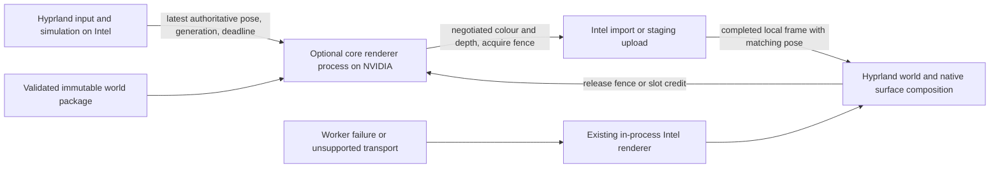
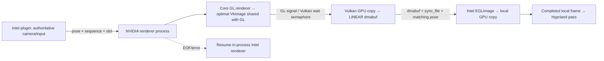

# NVIDIA → Intel offload feasibility spike

2026-10-08 · historical feasibility spike, disabled by default. Its prototype code, scripts
and raw evidence (about 29 MB of measurements and captures) were not merged; the production
design is RFC-0009 and `src/offload`. Evidence is cited below by name only.

**Current decision: go for optional quality headroom; no-go for promising native-4K Ultra at 60 FPS under the 50 W test ceiling.** Intel Auto now delivers ~60 FPS with dynamic resolution. NVIDIA delivers native-4K Ultra / 4× MSAA at 45 FPS, pose→ready p95 14–16 ms, peak 44–45 W. See [Quality headroom](#quality-headroom) for the published-main comparison.

**Historical round-2 decision: go for optional offload architecture; not production-ready.**
The Vulkan external-memory bridge reaches **60.0 completed FPS / 59.2 first
submissions per second**, versus **25.1 FPS Intel**, at native 4K. Pose→ready is
**14.05 ms median / 17.27 ms p95**, with **47.78 W** peak NVIDIA power. No CPU
pixel copies are used.
See [round 2](#round-2--reverse-allocation-and-vulkan-2026-10-08) for the revised
measurements, synchronization and recommendation. Local Intel rendering remains
the default/fallback. The following round-1 findings are retained as history.

**Round-1 decision (superseded): no-go for shipping the host path as a performance upgrade.** A separate
NVIDIA process can render the real Lumen Reach world and deliver pose-tagged
frames to the Intel plugin. The tested direct dmabuf paths fail; the host-memory
fallback works, but costs most of the NVIDIA rendering advantage. Keep the
in-process Intel renderer as the supported default. An optional renderer process
remains worth pursuing if a better transfer path is demonstrated.

This is a world-only prototype, not complete desktop offload. Native application
surfaces, depth transport, editor transforms, shell styling, world transitions,
HDR and output transforms are not transported. Round 1 made no claim of 60 FPS. Neither round measures physical
motion-to-photon latency.

## Machine, isolation and power

- Intel Panther Lake / xe, `/dev/dri/card0`, `renderD128`; all physical displays
  remain driven by Intel. Nested GL reports `Mesa Intel(R) Graphics (PTL)`.
- RTX 5090 **Laptop**, proprietary NVIDIA **615.71.09**, `card1`, `renderD129`.
  The worker enumerates EGL devices by render-node path, initializes a usable
  entry, and requires `GL_RENDERER` to contain NVIDIA. No GPU index assumption.
- Initial `AC0/online=1`; USB-C source 1 online, source 2 offline; battery
  “Not charging”. An online AC flag does **not** establish the adapter wattage.
- Every GPU test held `/tmp/worldshell-nested.lock`. Nested tests used this
  worktree's copied harness and verified `ctl.py`. No outer `hyprctl`, plugin
  load, settings change, power-limit change, clock change or live-session signal.
- Short 15/30 FPS runs, 45 frames for 4K standalone measurements, roughly six
  seconds of motion per recording. Worker limit: 30 FPS and 30 seconds of render
  requests. Launcher watchdog: 55 seconds after acquiring the lock, AC checked
  about every 100 ms, telemetry every 500 ms, stop above 50 W or 75°C. Renderer
  also checks AC before each frame. These conservative test ceilings are not a
  certification of USB-C electrical safety.
- Original measurements used synchronous `nvidia-smi` queries (up to ~3 seconds
  first-query startup). The final watchdog uses continuous telemetry and waits
  for a valid first reading before launching. A recorded timeout happened while
  waiting for another task's lock, before any spike renderer ran; the final
  launcher acquires the lock before starting its watchdog.
- The outer session and other normal applications still share both physical
  GPUs. Power values are whole-device readings, not isolated process power or
  whole-laptop power. P-state changes are observations, not forced settings.

Environment: environment.json. The world author changed
`worlds/dist` while this spike was running. Earlier measurements are exploratory;
final paired nested captures use a frozen worktree-local `build/dgpu-world` copy.
The reports contain matching package hashes; the full content manifest is
pinned-world.json. No shared world asset was edited.

## Driver and transport findings

| Probe | Observed result |
| --- | --- |
| `EGL_EXT_device_enumeration` / `EGL_EXT_platform_device` | Works on NVIDIA and Intel |
| Duplicate EGL render-node entries | Mesa also enumerated NVIDIA's node; choosing the last matching entry failed `eglInitialize`. Select the first successfully initialized matching device instead. |
| NVIDIA GBM backend | `nvidia`; explicit `open(renderD129)` |
| `EGL_MESA_image_dma_buf_export` | NVIDIA ordinary RGBA8 texture exports one AB24 / ABGR8888 plane |
| Ordinary NVIDIA texture modifier | `0x0300000000e08013` (NVIDIA-specific tiled layout) |
| Intel import of exported NVIDIA texture | `eglCreateImageKHR`: `EGL_BAD_MATCH` (`0x3009`) |
| NVIDIA ABGR8888 modifier query | Twelve NVIDIA modifiers, plus LINEAR (`0`) with `externalOnly=true` |
| Explicit LINEAR + RENDERING via `gbm_bo_create_with_modifiers2` | Allocation fails |
| LINEAR + RENDERING via legacy `gbm_bo_create` | Allocation fails |
| LINEAR without RENDERING | Allocation and EGLImage import succeed; binding as `GL_TEXTURE_2D` fails, so it cannot serve as this GLES render target |
| `EGL_ANDROID_native_fence_sync` | Advertised on both drivers; NVIDIA export to `sync_file` and poll signaling work in the host path |
| NVIDIA → shared host memfd → Intel texture | Works at 3840×2160 with correct orientation and pose identity |

Raw failures: linear, worker log,
native tiled import. The LINEAR test fails on NVIDIA before
an Intel import can be attempted; do not describe it as an Intel LINEAR rejection.
This does not prove every possible NVIDIA API/format/allocator path is impossible.
Vulkan transfer destinations, PBO/external-memory copies, alternate packed formats,
and Intel-allocated export/import in the reverse direction remain untested.

The export/import implementation follows the
[Khronos dmabuf export contract](https://registry.khronos.org/EGL/extensions/MESA/EGL_MESA_image_dma_buf_export.txt).
A rendering fence is created, flushed and duplicated to an FD using
[`EGL_ANDROID_native_fence_sync`](https://registry.khronos.org/EGL/extensions/ANDROID/EGL_ANDROID_native_fence_sync.txt).
The consumer polls the sync_file, closes it and uses a local GL fence before slot
reuse. It does not currently import release fences into NVIDIA EGL. Direct
cross-driver GPU fence waiting on a successfully imported dmabuf remains unproven.

## Measurements

All standalone cases use the existing core `Renderer`, Lumen Reach arrival,
3840×2160 RGBA8, fixed native render scale, **the same Intel quality tier**
(2× MSAA, lower environment/anisotropy tier), with a small yaw sweep. Five startup
frames are excluded, leaving 40 samples. No live application surfaces. Median /
p95 milliseconds use nearest-rank p95. `renderMs` is wall time through GPU
completion, not an asynchronous elapsed-time query.

| Standalone path | Render | NVIDIA readback | Intel upload + copy completion | Pose → Intel ready | Fresh-frame interval |
| --- | ---: | ---: | ---: | ---: | ---: |
| In-process Intel, 15 FPS cap | 28.27 / 29.59 | — | — | 28.27 / 29.59 | 66.70 / 69.32 |
| NVIDIA host copy, 15 FPS cap | 2.29 / 2.41 | 3.03 / 3.55 | 39.17 / 40.46 | 46.18 / 47.70 | 67.08 / 69.53 |
| NVIDIA host copy, 30 FPS cap | 2.34 / 2.43 | 3.60 / 4.08 | 20.97 / 22.38 | 28.85 / 30.84 | 33.91 / 35.70 |

The 30 FPS standalone run achieved **29.59 fresh FPS**. The substantial variation
in Intel completion cost between capped runs warns against extrapolating isolated
copy bandwidth or subtracting unrelated medians as a causal latency measurement.
Each frame is 33,177,600 bytes (31.64 MiB); at 30 FPS each transfer direction moves
about 0.995 GB/s, before staging and local blits. The measured host path includes
synchronous `glReadPixels` on NVIDIA, upload submission on Intel and a local copy
into the presentation buffer. It is not a PCIe-only bandwidth test.

Final **nested plugin** comparison, frozen identical package and 4K quality,
sequential six-second recordings (not exclusive GPU ownership):

| Path | Fresh FPS | NVIDIA render ms | Readback ms | Intel copy completion ms | Pose → ready ms | Pose → plugin submit ms | Fresh interval ms |
| --- | ---: | ---: | ---: | ---: | ---: | ---: | ---: |
| In-process Intel | 25.42 | — | — | — | not instrumented | not instrumented | not individually sampled |
| NVIDIA host copy, 30 FPS cap | 25.05 | 2.47 / 3.46 | 4.15 / 5.35 | 16.94 / 18.42 | 33.67 / 35.41 | 38.36 / 41.01 | 34.25 / 51.38 |

Offload: 157 samples after discarding five startup frames. Its fresh FPS is
computed from completed-copy timestamps. Intel counts fresh world submissions
over the observation interval with at most two in flight. The difference is small
and these are sequential shared-machine runs: there is **no demonstrated speedup**.
The standalone measurements above used an earlier Lumen package and precede
the final poll-order fix (one extra ~1 ms polling iteration there, one compositor
tick in nested). Do not treat them as the exact same workload as this final pair.

`consumerMs` includes polling cadence and GPU scheduling as well as transfer.
`consumerSubmitMs` separately records the CPU upload/blit call time. The plugin
checks completion on its existing deferred tick. The initial consumer needlessly
waited another tick before processing an already-received fence; the final code
polls it in the receiving tick. Before/after evidence is retained, so this
avoidable scheduling delay is not mistaken for cross-GPU bandwidth cost.

The standalone Intel benchmark uses `glFinish` **only in that benchmark** to
measure completion. Production and spike presentation never use `glFinish`.
The worker waits for its own render fence (maximum two seconds) to separate
render and readback cost; it never makes Hyprland wait for the worker's fence.
Host uploads can still consume compositor-thread time; nonblocking protocol
handling does not make a GL upload free.

### Latency scope

`sent` timestamps the authoritative pose when the plugin requests a frame.
`readyMs` ends when Intel's local copy fence has completed and the plugin observes
it. `firstPresentMs` ends at the first plugin blit **submission** of that frame.
These are software latency proxies. They omit physical input sampling before
`sent`, outer compositor presentation, scanout and panel response. The nested
headless output cannot measure photons; a photodiode/high-speed camera test would
be needed before claiming physical motion-to-photon latency or its added delta.

One nested real-seat WASD probe records the time from launching `wtype` to the
first completed/presented frame with a changed pose. It includes helper startup
and seat delivery and is a single integration sample, not a latency distribution.
The final single seat probe measured **115.60 ms to matching Intel-ready frame**
and **130.04 ms to plugin blit submission**, including `wtype` launch/seat delivery.
This is not an added-latency delta against an Intel input test.
Camera replies retain the exact six values (position, yaw, pitch, FOV) supplied
for their sequence. The nested harness verifies monotonic unique sequence IDs
and matches input-derived movement to a returned frame.

### Power

| Run | NVIDIA watts median / max | Observed P-states |
| --- | ---: | --- |
| intel-4k | 20.12 / 21.17 | P2 |
| host-4k | 24.07 / 26.77 | P2 |
| host-4k-30 | 22.80 / 27.49 | P2, P4, P8 |
| nested-intel | 7.54 / 21.22 | P2, P8 |
| nested-host | 26.07 / 32.40 | P0, P2, P4, P5 |

Final nested offload peak: **32.40 W**, below the 50 W stop ceiling; AC stayed online.

Idle/offload P-state behavior is not established by these brief runs. A P0/P2
reading does not by itself mean high draw, and other session activity can keep
NVIDIA awake. No persistent clock, power or persistence-mode setting was changed.

## Prototype and RFC-0002 fit

`HYPRUNE_DGPU_SPIKE` defaults OFF. The spike adds:

- `hyprune-render`: core's real loader and renderer in an independent EGL process;
  `host`, `linear` and `native` transport probes, hard device and safety bounds.
- `spike::Client`: inherited `SOCK_SEQPACKET`, nonblocking compositor-side I/O,
  `SCM_RIGHTS`, two exported/mapped producer slots, two Intel presentation buffers,
  zero-timeout producer/local fence checks, pose-tagged timing records.
- `dgpu-benchmark`: Intel context consumer and Intel in-process baseline.
- An opt-in nested-only Lua diagnostic, `hl.plugin.hyprune.offload(mode)`.
  Allocation/import/upload and pose requests occur outside render passes. The
  pass blits only a completed local front buffer. Unavailable/failed offload
  uses the existing Intel renderer. The ordinary build and default stay local.

Private protocol v1 is build-pinned, not RFC-0003 public IPC. A dedicated child
gets FD 198 through `posix_spawn`; no public listener or external path command.
Packets are bounded to 16 KiB and at most four descriptors. Startup sends device
capabilities, two buffer descriptors and `ready`. A pose request carries version,
sequence, slot, monotonic timestamp and six pose floats. A frame response echoes
the identity and pose, adds render/copy timings, and attaches an acquire sync_file.
For the host path the persistent memfds carry tightly packed RGBA8 pixels.

There is **one outstanding pose request**, alternating two slots. The next request
is sent only after the Intel copy completes, which serves as the previous slot's
release acknowledgement. This conservative ownership rule prevents producer
reuse while the consumer reads; it is not a fully pipelined triple-buffer design.
At most one old and one new local presentation image exist. The consumer retains
the last completed frame, never an unbounded camera/frame backlog.



For production, keep input, focus, surface leases and final presentation under
Hyprland authority exactly as RFC-0002 requires. The daemon/supervisor should own
worker lifetime and immutable package generations. Negotiate formats/modifiers
with a real import/render test before enabling offload. Use session epoch, world
and output generations, bounded deadlines, release fences and latest-pose
coalescing; discard stale replies. These generation/epoch/restart facilities are
architecture recommendations, **not implemented** by the fixed-world spike.

An external renderer is not a second compositor or input authority. To preserve
native window sharpness, rendering windows on Intel needs matching world depth
and camera. Alternatively exporting approved client textures to NVIDIA creates
reverse-direction transfer, lease, color and synchronization costs. Neither route
is tested here. Keep local rendering selectable even if a future transport works.

### Failure behavior and remaining risks

- Nested harness deliberately SIGKILLs only the verified renderer child, observes
  EOF, and checks that fresh Intel world frames resume while Hyprland stays active.
  The final check observed 14 additional Intel world submissions within its
  500 ms recovery window. This demonstrates process crash isolation; a GPU driver hang can still affect
  shared kernel/display infrastructure.
- Worker EOF/timeout falls back; world replacement and exit stop the worker.
  Existing Intel assets stay resident for immediate fallback. That duplicates
  world memory and is not an optimized final architecture.
- Teardown currently SIGTERMs and reaps the child outside rendering. Waiting for
  a stuck child during teardown is a spike limitation; production supervision
  must be asynchronous. It checks child ownership before signaling/reaping.
- No physical-display, suspend/resume, multi-output, GPU reset, HDR, long-duration
  thermal, battery or session-lock acceptance is claimed. No live session test.
- Host copies and local blits add bandwidth, memory and latency. A CPU-mapped
  ring with asynchronous PBO staging could improve throughput, but must be
  measured instead of assuming overlap removes this cost.
- Direct dmabuf failure may be driver/API/format-specific. Test another transfer
  API or Intel-allocated buffers before rejecting the architecture altogether.

## Verification, recording and reproduction

Nine CTests pass, including a new private-protocol FD/packet/EOF test and the
existing software GL rendering regressions. The inherited render test had a
same-scope `magenta` variable collision; this branch only renames the material
variable to allow that suite to build. CTest output.

The final nested test checks actual 3840×2160 output, NVIDIA worker identity,
pose sequence consistency, real seat movement, correct displayed pixels, and
renderer crash fallback. The 4K host/Intel standalone captures at matching poses
had mean absolute RGB differences of 0.325 / 0.381 / 0.337 on a 0–255 scale;
small cross-driver shader differences remain. Nested stills were visually checked
for orientation. These are world-render checks, not native-window conformance.

The review video `hyprune-dgpu-spike.mp4` and its `.json` compare sequential
locked nested recordings of the same camera sweep, native 4K rendered at equal
quality, downscaled for side-by-side viewing. FPS overlays report fresh-world
rates from retained measurements, not the recording's 30 FPS container rate.
Intel counts new submissions with at most two frames in flight; offload counts
completed copies. Thus the rates are useful short-run proxies, not hardware
presentation timestamps. The video is explicitly labeled world-only / host copy.
Encoding happens in `/tmp` before the finished pair is published for review.

Build and run only in this worktree, on AC:

```sh
cmake -S . -B build -G Ninja -DHYPRUNE_DGPU_SPIKE=ON
cmake --build build -j3
# Pin once; never reuse a mutable worlds/dist path across compared recordings.
cp -a ../worlds/dist/com.hyprune.lumen-reach build/dgpu-world
ctest --test-dir build --output-on-failure

# Companion to run.sh: same session.py and verified ctl.py; lock covers lifetime.
HYPRUNE_DGPU_FPS=30 dev/nested/dgpu-run.sh host --record
dev/nested/dgpu-run.sh intel --record

# Standalone device-context comparison, still under the shared GPU test lock.
HYPRUNE_DGPU_FPS=30 flock /tmp/worldshell-nested.lock \
  python3 dev/nested/dgpu-power.py /tmp/offload-power.json \
  build/dgpu-benchmark ../worlds/dist/com.hyprune.lumen-reach \
  host 3840 2160 45 /tmp/offload.json
# Substitute intel, or linear/native at 640 360 with 3 frames for compatibility.
python3 dev/nested/dgpu-report.py
```

Raw measurements and a machine-readable summary were recorded with the spike.
A six-second forced watchdog test unwound the nested controller, terminated its
separate compositor session, and left no spike worker alive. See
watchdog-stop.json. AC-loss itself was not physically
induced; the watchdog test exercises the same cleanup route.

The initial device-selection failure and early polling implementation are retained
as negative evidence; headline findings use the final nested implementation and frozen package. Reports
with `unfrozen`, `before-poll-fix`, or `15` in their names are exploratory, not
the final paired comparison.

## Round 2 — reverse allocation and Vulkan (2026-10-08)

Round 2 supersedes the round-1 transfer conclusion. **Vulkan can bridge the
existing NVIDIA GL renderer to an Intel-importable LINEAR dmabuf.** This is a
performance feasibility result, not approval to ship the spike as a desktop
renderer. All experiments still use the isolated worktree, nested compositor,
shared lifetime lock and the same AC/power watchdog. No driver settings, power
limits or outer-session configuration were changed.

### What failed, what worked

| Allocation / API | Result at 3840×2160 |
| --- | --- |
| Intel GBM LINEAR → NVIDIA EGLImage → GL_TEXTURE_2D | EGLImage creation succeeds; texture binding fails with GL_INVALID_OPERATION (1282); incomplete attachment (36054) |
| Intel GBM LINEAR → NVIDIA EGLImage → renderbuffer | Same failure at glEGLImageTargetRenderbufferStorageOES; no renderable FBO |
| NVIDIA Vulkan modifier LINEAR → dmabuf → Intel EGL texture/FBO | Works; correct clear pixels, native sync_file and actual Lumen Reach frames |
| Intel GBM LINEAR → NVIDIA Vulkan imported memory → Intel EGL texture/FBO | Works, including actual Lumen Reach frames |
| Intel's three additional non-external-only modifiers → NVIDIA Vulkan | VK_ERROR_FORMAT_NOT_SUPPORTED (-11) |
| GL optimal external memory → Vulkan copy into LINEAR | Works via GL_EXT_memory_object_fd plus GL_EXT_semaphore_fd |

The reverse-GL matrix covers ABGR8888 and ARGB8888, each with LINEAR + RENDERING,
LINEAR + SCANOUT, and all three flags, on both GL targets: **12 failed attachment
attempts after successful allocation and EGLImage creation**. Intel GBM rejects
`gbm_bo_create_with_modifiers2` when explicit modifier LINEAR is combined with the
redundant `GBM_BO_USE_LINEAR` flag here. Passing the explicit LINEAR modifier with
the remaining usage flags succeeds. The probe retains both outcomes. No
sync_file can validate a rendered GL frame when the FBO itself is incomplete.
Dumb/udmabuf allocation was unnecessary once real Intel GBM buffers worked.

Vulkan reports importable/exportable external memory for LINEAR RGBA8 with
TRANSFER_DST/SRC, both with and without COLOR_ATTACHMENT usage. Four clear tests
(NVIDIA allocation and Intel allocation, two usages each) produced the expected
Intel pixel `[64,128,191,255]` after a signaled sync_file. Clear-to-fence was
2.43–2.59 ms for NVIDIA allocation and 1.54–1.63 ms for Intel allocation. These
are capability probes, **not world-rendering benchmarks**. The tested non-LINEAR
Intel modifiers were `0x0100000000000001`, `0x0100000000000009`, and
`0x0100000000000010`.

The modifier and external-memory mechanisms are specified separately by
[VK_EXT_image_drm_format_modifier](https://docs.vulkan.org/refpages/latest/refpages/source/VK_EXT_image_drm_format_modifier.html)
and [VK_EXT_external_memory_dma_buf](https://docs.vulkan.org/refpages/latest/refpages/source/VK_EXT_external_memory_dma_buf.html).
In this driver, EGL's LINEAR external-only limitation does not imply Vulkan
cannot write a LINEAR image. Actual allocation, attachment, import and pixel
checks—not advertised extensions alone—establish the working route.

Evidence: reverse GL matrix,
Vulkan capabilities, modifier lists and clear checks,
round-2 computed summary. Raw JSON records retain
pose IDs, per-stage timing, extension lists and separate power samples.

### Actual world path and synchronization



In the `vkreverse` worker, allocation is made through Intel GBM on renderD128
inside the renderer process, then imported into NVIDIA Vulkan; the plugin
receives the same exported dmabuf. Allocation is on Intel, but this spike does
not yet move allocator ownership into the plugin's process.

Two external producer slots and three local Intel color targets bound storage.
No CPU pixel readback/upload is used on the Vulkan path. The GL render target is
an optimal Vulkan image imported through an opaque memory FD; binary external
semaphores transfer ownership between GL and Vulkan. Vulkan copies it into a
LINEAR RGBA8 destination, releases it to the foreign queue family, and exports a
native sync_file. Intel polls the acquire fence without blocking, imports the
buffer as an EGLImage/texture, and copies it to a local target. A local GL fence
must signal before that target becomes eligible for presentation and before
reusing the external slot. Thus **dmabuf import avoids CPU copies, but the whole
pipeline is not zero-copy**: there is a NVIDIA optimal→LINEAR copy and an Intel
local-texture copy. Each full 4K RGBA8 frame is 33,177,600 bytes.

The private SOCK_SEQPACKET protocol is version 2. Requests contain sequence,
slot, monotonic issue timestamp and six camera values. Replies echo the exact
pose and sequence; the consumer rejects mismatches and only promotes newer
frames. Only two requests can be outstanding; simulation and input authority
remain in the plugin. Startup sends two buffer FDs and their format/modifier,
stride and offset. Frames carry an acquire fence FD. The next request for a
slot is its release acknowledgement after the Intel copy fence. This local
retirement step makes the external buffer independent of scanout lifetime.

The plugin pumps completion separately from its simulation timer. No render
thread or GL context crosses processes, and no blocking GPU wait is added to the
Hyprland pass. Failure/deadline/EOF switches back to the local renderer. Startup,
allocation and resource teardown remain spike-quality and can have CPU stalls.
The nested acceptance test checks actual seat input reaching tagged frames and
kills only its verified renderer child to demonstrate compositor survival.

### Measurements and method

All world measurements pin the same Lumen Reach package as round 1 and keep
`renderScale=1`, at native 3840×2160. The high preset uses 4× MSAA; the default
round-2 preset uses the same Intel/2× MSAA quality as round 1 on **both** GPUs
(including the 64-resolution environment cache and 2× anisotropy cap).
GPU timestamp durations include the real core world rendering. Pose→ready ends
only when Intel's local-copy fence is observed complete. First-submit ends at
the first plugin blit submission for that pose; neither measures physical
scanout or photons. FPS counts completed fresh frames, not repeated compositor
presentations. First-submit FPS is reported separately where available.

Five startup frames are excluded from latency/pacing statistics. The scripts
report nearest-rank p95. Runs are sequential and short (40–120 standalone
frames, approximately six seconds of nested motion). Whole-device power samples
include initialization, warmup and teardown and are not process energy. Short
runs and shared GPU activity do not establish steady-state thermal efficiency.

Standalone (all output native 4K; cap is not an uncapped GPU limit):

| Path | MSAA / cap | Fresh FPS | Pose→ready median / p95 ms | NVIDIA peak W |
| --- | --- | ---: | ---: | ---: |
| Intel in-process | 2× / 60 | 32.70 | 30.35 / 32.05 | 14.55 |
| NVIDIA-owned LINEAR | 2× / 60 | 58.72 | 10.82 / 13.10 | 47.05 |
| Intel-owned LINEAR | 2× / 60 | 59.80 | 13.61 / 15.89 | 48.58 |
| NVIDIA-owned LINEAR | 4× / 30 | 29.66 | 11.45 / 15.12 | 33.54 |
| Intel-owned LINEAR | 4× / 30 | 29.71 | 10.41 / 12.37 | 33.48 |

The standalone 60 FPS allocation comparison predates the final worker cap
scheduling fix; its raw results are retained rather than mixed with new runs.
The final nested rows below use the corrected client/worker pacing. The small
difference between allocation modes is not a statistically established win.

| Nested path, 2× MSAA | Fresh FPS | First-submit FPS | Pose→ready median / p95 ms | First-submit median / p95 ms | NVIDIA peak W |
| --- | ---: | ---: | ---: | ---: | ---: |
| Intel, no recording | 25.10 | same submission counter | — | — | 20.90 |
| NVIDIA Vulkan, no recording | 60.02 | 59.18 | 14.05 / 17.27 | 23.89 / 24.88 | 47.78 |
| Intel, recording | 25.71 | same submission counter | — | — | 17.79 |
| NVIDIA Vulkan, recording | 57.85 | 48.67 | 22.87 / 36.56 | 23.61 / 39.39 | 48.13 |

**The normal nested run meets ≥55 FPS and <25 ms pose→ready at p95.**
Its worst pose→ready sample was **27.05 ms**, so this is not a
hard maximum-latency guarantee. The 60.02 completed-FPS estimate reflects
finite-window completion timing around a configured 60 FPS submission cap.
Compared with 25.10 fresh Intel submissions/s, this is about 2.4× throughput.

| Final nested NVIDIA stage / pacing | Median ms | p95 ms |
| --- | ---: | ---: |
| NVIDIA core world render, GPU | 4.095 | 4.701 |
| NVIDIA optimal→LINEAR copy, GPU | 1.291 | 1.529 |
| Intel LINEAR→local texture copy, GPU | 1.343 | 1.374 |
| Pose issue→NVIDIA completion observed | 6.296 | 7.910 |
| Completed fresh-frame interval | 16.206 | 23.395 |

The two GPU copy stage medians sum to **2.63 ms** in the final nested run;
CPU polling, IPC, compositor scheduling and other queued GPU work explain the
rest of pose→ready. This is substantially cheaper than the round-1 host path.
NVIDIA world rendering here is about 4.1 ms; do not substitute the earlier
round-1 ~2.4 ms result into this pipeline, whose target allocation, timing scope
and clock behavior differ.

Normal nested frame-interval p95 is 23.40 ms (worst 31.06 ms). Recording raises
that to 32.29 ms and reduces distinct first submissions to 48.67/s even though
57.85 completed textures/s are observed. The video labels recording and normal
rates separately. It is a 30 FPS illustration, not a 60 Hz scanout measurement.

The one real-seat input check measured **68.10 ms command launch→matching
completed pose**, or 71.40 ms to first plugin submission. This includes wtype
startup, seat delivery and simulation scheduling, so it must not be presented
as the 14.05 ms pose-request latency or as physical motion-to-photon.
After SIGKILL of the verified worker, nested Hyprland stayed active and local
world frames advanced from 32 to 46 within the recovery check.

NVIDIA power is whole-device telemetry, including background activity even in
the Intel rows. It is **not Intel or whole-laptop power**. The final offload run
observed P0/P2 under work and P4/P8 around initialization; peak temperature was
52°C. The near-48 W peaks warrant a conservative power policy; these short
runs do not establish sustained USB-C suitability.


A 4× MSAA / 60 FPS attempt hit **50.37 W** and was terminated by the unchanged
50 W watchdog; no completed performance result is claimed for it. The 4× MSAA
30 FPS runs completed. The 2× MSAA runs keep the round-1 quality and remain
below the guardrail. NVIDIA enters P2 and sometimes P0 under this work; P0 is
not automatically unreasonable, but the measured power leaves little USB-C
headroom. AC stayed online. This does not certify the adapter's wattage.

Two exploratory artifacts are deliberately excluded from the final performance
recommendation: `vk-world-15` blitted the same front texture on every benchmark
poll, artificially queuing Intel GPU work; the benchmark now presents once per
fresh frame. `nested-vklinear-queued-pilot` exposed drift between independent
relative worker and absolute client FPS caps. The final worker retires completed
slots while awaiting an absolute submission deadline, avoiding sleeps that
held back completed replies. Their raw records remain for traceability.

### Reduced-resolution host fallback

The user made the reduced-resolution matrix conditional on **only host transfer
working**. Vulkan succeeded at full native resolution, so there is no need to
trade resolution for bandwidth in the recommendation. An optional
`hyprune-render-async` experimental fallback uses two fenced pixel-pack buffers,
shared memfd slots, and persistent coherent Intel pixel-unpack buffers when
GL_EXT_buffer_storage is available. It supports 2160p/1440p/1080p transfer from
a full-resolution render, with the core bounded .35 sharpen formula on Intel.
That reconstruction operates on already-tonemapped color, unlike core's
pre-tonemap stage; it is not an assertion of identical image quality. No
comparative reduced-resolution performance claim is made. A 12-frame, 15 FPS
1080p-transfer smoke run verifies the double-PBO path and persistent Intel
upload; 1440p and 2160p async modes are implemented but not benchmarked here.

### Recommendation, RFC-0002 fit and remaining risks

**Go for an optional renderer-process architecture and further engineering;
no-go for merging this prototype as a production desktop backend.** Keep local
Intel rendering as the default and mandatory fallback. Capability negotiation
should select the tested Vulkan LINEAR bridge, with Intel allocation as an
alternative, only after validating actual import/attachment/fence behavior.
Prefer the ordinary local renderer to silently degrading to an expensive host
copy when offload is unavailable. Keep explicit device selection and a user
power/performance policy; do not make dGPU availability a requirement.

This fits RFC-0002 by separating world-rendering execution from compositor/input
ownership. The private spike channel needs a supported versioned lifecycle:
GPU identity/capability handshake, bounded buffers, camera/state snapshots,
frame/pose identities, explicit acquire/release synchronization, backpressure,
timeouts, process restart and seamless local fallback. Launcher supervision
belongs with the runtime/daemon process model; the spike's direct posix_spawn
is a proof of isolation, not the final public RPC interface. GL/Vulkan shared
memory and semaphore semantics are described by Khronos's
[external objects](https://registry.khronos.org/OpenGL/extensions/EXT/EXT_external_objects.txt)
and [FD import](https://registry.khronos.org/OpenGL/extensions/EXT/EXT_external_objects_fd.txt)
extensions; retain explicit ownership/layout transitions in a production design.

Missing production work includes desktop surface and depth transport,
zero-stall startup, resizing, output transforms/HDR, lock/suspend/resume,
world/editor-state updates, GPU-reset recovery, shader/color equivalence,
resource cleanup under partial initialization, malformed-peer hardening and
validation on other drivers. No Vulkan validation layer is installed on this
machine, so successful pixels and repeated real interop do not replace a
validation-layer review. A renderer process crash is isolated; a driver/GPU hang
can still affect the shared system and is not contained by process boundaries.
Timing is camera-request→completed texture, not physical motion-to-photon.

### Reproduce safely

Validation: all nine existing CTest suites pass, including protocol FD/EOF
checks. A separate `HYPRUNE_DGPU_SPIKE=OFF`, `BUILD_TESTING=OFF` build of the
plugin also passes and has no Vulkan/NVIDIA dynamic dependency. The nested
acceptance runs exercise real imports, camera poses, seat input, EOF and local
fallback; the API probes exercise clear-pixel correctness on Intel.

The following round-2 reproduction commands describe commit `03965ce`; use the
quality-headroom launcher below for the merged renderer/presets.

Build with `-DHYPRUNE_DGPU_SPIKE=ON` (still OFF by default). New targets are
`dgpu-reverse`, `dgpu-vulkan-probe`, `hyprune-render-vulkan`, `dgpu-round2`, and
`hyprune-render-async`. Vulkan headers/loader are needed only for the opted-in
spike. Use the pinned `build/dgpu-world` package, not a changing world build.
For a short standalone run, hold the same lock around `dgpu-power.py` and
`build/dgpu-round2 build/dgpu-world vklinear 60 100 OUTPUT.json`; substitute
`vkreverse` or `intel` to compare. Set `HYPRUNE_DGPU_HIGH=1` only for the tested
30 FPS high-quality case. Do not repeat the aborted 60 FPS high-quality load.

For nested runs:

```sh
HYPRUNE_DGPU_ROUND2=1 HYPRUNE_DGPU_FPS=60 dev/nested/dgpu-run.sh vklinear
HYPRUNE_DGPU_ROUND2=1 HYPRUNE_DGPU_FPS=60 dev/nested/dgpu-run.sh intel
python3 dev/nested/dgpu-report-2.py
```

`--record` records only the nested HEADLESS-1 output. The output stays 4K; the
recorder scales to 960×540 before CPU encoding to reduce recording overhead.
`HYPRUNE_DGPU_TAG=-video` keeps its measurements separate. New renderer runs
have a 15-second rendering budget and a maximum cap of 60 FPS; the existing
55-second launcher, continuous AC checks and 50 W/75°C stop conditions remain.
Never substitute an outer-session plugin load or raise those ceilings.

Round-2 comparison video: `hyprune-dgpu-spike-2.mp4` and its `.json` sidecar.
Six seconds, 1920×710 at 30 FPS, sequential nested recordings; final CPU encoding
in `/tmp` before the pair is published for review.

## Quality headroom

2026-10-08, after merging published `origin/main` **ad81f24** into the spike
(**6412298**). This includes the final presets, graphics IPC 0.7/0.8, BVHs,
incremental uploads and separate native transparency composition. Core main
was not edited. This comparison supersedes the old 25.1 FPS Intel baseline
for decisions about today's Auto preset.

**Go for optional image-quality headroom; no-go for promising native-4K Ultra
at 60 FPS within this laptop's 50 W test ceiling.** Intel Auto already delivers
60 FPS. Offload adds native world resolution, the Ultra effects and 4× MSAA:
45 FPS completed in both scenes, with pose→ready p95 below 17 ms and observed
NVIDIA peaks below 46 W. It does not improve Auto's frame rate at that setting.
At equal native Ultra settings Intel delivered 15–17 FPS. Keep Intel Auto as
the default, particularly on battery or an unqualified USB-C supply.

### Method and effective quality

All cases used the same pinned Lumen Reach package, this worktree's nested
harness, Intel composition and **3840×2160 output**. Native output does not
mean native world shading: the effective scale is measured below. Fixed camera
poses are Sun Court `(-8, 1.7, 12)` and Rime Vault `(38, -4.3, -79)`, yaw/pitch
zero, FOV 60°. No live application windows were opened. The cards, driver and
world hashes are unchanged from round 2.

Intel runs have eight seconds of settling followed by about four seconds of
observation; NVIDIA has 0.5 seconds after first availability and about four
seconds of observation. These are short operating samples, not thermal or
battery-life qualification. Two initial two-second-warmup pilots are retained
as `*-warmup2`, excluded from the tables: Intel High was still descending through
scales and gave a misleading transient 43.59 FPS. The final High run settled
at 59.93 FPS / 0.375 scale. Dynamic Auto continues to adapt even after warmup.

- **Auto on Intel selects Low:** 1× MSAA, bloom off, linear fog, gradient sky,
  reflection/normal/specular shading off, AO on, alpha haze off, anisotropy 1.
- **High:** 2× MSAA, high bloom, height fog, environment sky, reflections,
  normal maps, specular, AO and alpha haze on, anisotropy 8.
- **Ultra:** the same effects, 4× MSAA and anisotropy 16. 4× is the largest
  supported preset MSAA value. The 2× trial overrides only MSAA.
- NVIDIA world shading is fixed at scale 1.0 with dynamic resolution disabled.
  Intel Auto/High/Ultra retain main's dynamic resolution; a separate native
  Intel Ultra run explicitly disables it to compare equivalent resolution.
- “All effects” means all **implemented** preset effects, not new SSR, runtime
  shadows or contact shadows. Baked asset shading remains in every preset.
  Both paths use the world's atmosphere (exposure 1, bloom strength 0.12).
  Worker `caps.graphics.bloom_strength` still reports the generic 0.15 default;
  actual drawing uses `Renderer::profile`, populated from the world. This is
  diagnostic metadata drift, not an applied 0.15 override.

Raw reports, per-frame worker timings and watchdog telemetry were recorded with
the spike (`evidence/quality`, aggregate `summary.json`). FPS is Intel's rendered-frame
count over the observation interval or NVIDIA's completed-frame rate; neither
is physical scanout/photons. Intel frame intervals are sampled renderer
telemetry; NVIDIA intervals cover each completion. Percentiles are nearest-rank.

### Intel in-process matrix

| Preset | MSAA | Sun Court FPS | Sun frame interval median / p95 ms | Sun effective scale | Rime Vault FPS | Rime frame interval median / p95 ms | Rime effective scale |
| --- | ---: | ---: | ---: | --- | ---: | ---: | --- |
| Auto → Low | 1× | 59.99 | 16.70 / 16.82 | 0.50–0.5625 | 60.10 | 16.65 / 16.76 | 0.4375 |
| High | 2× | 59.93 | 16.67 / 16.73 | 0.375 | 59.98 | 16.68 / 16.75 | 0.375 |
| Ultra | 4× | 56.79 | 16.65 / 33.48 | 0.375 | 58.56 | 16.68 / 16.80 | 0.375 |
| Ultra, forced native | 4× | 15.36 | 66.68 / 66.77 | 1.0 | 17.04 | 66.63 / 66.79 | 1.0 |

Auto's world target is 1920×1080–2160×1215 in Sun Court and 1680×945 in Rime
Vault. High/Ultra settle at the floor, 1440×810, while native surfaces/output
remain 4K. Offload shades **3.16–5.22× as many world pixels as measured Auto**,
or **7.11× as many as dynamic High/Ultra**, plus the stated effects/MSAA.
Sampled frame intervals need not be the reciprocal of aggregate FPS: they
miss some frame gaps and the telemetry is read at about 120 ms intervals.

### NVIDIA Ultra through Vulkan LINEAR

| View | MSAA / cap | Completed FPS | Pose→Intel-ready median / p95 ms | Render GPU median ms | Completion interval median / p95 ms | NVIDIA peak W | Result |
| --- | --- | ---: | ---: | ---: | ---: | ---: | --- |
| Sun Court | 4× / 30 | 30.00 | 12.94 / 14.53 | 4.639 | 33.19 / 35.05 | 34.23 | Completed pilot |
| Sun Court | 4× / 45 | 45.01 | 12.08 / 16.10 | 4.690 | 22.23 / 26.23 | 43.73 | Completed |
| Rime Vault | 4× / 45 | 45.01 | 12.08 / 14.37 | 4.804 | 22.15 / 26.42 | 45.44 | Completed |
| Sun Court | 4× / 60 | 59.77* | 14.10 / 14.87* | 4.640* | — | 50.56 | Watchdog aborted |
| Sun Court | 2× / 60 | 59.98 | 10.13 / 14.25 | 4.487 | 16.16 / 20.45 | 49.34 | Completed, little margin |
| Rime Vault | 2× / 60 | 59.94* | 12.12 / 14.29* | 4.677* | — | 50.41 | Watchdog aborted |

`*` Partial observations before the stop, **not passing results**. No repeat of
the failing 4×/60 load was attempted. Lowering MSAA alone did not make 60 FPS
pass both viewpoints. The 45 FPS profile has not been proven safe on every
scene, supply or sustained workload.

At 45 FPS, median NVIDIA optimal→LINEAR copy costs **1.299 / 1.303 ms**
(Sun/Rime); Intel LINEAR→local copy costs **1.327 / 1.334 ms**. Fresh first
plugin submissions were **44.94 / 45.13 FPS**. Pose→first submission was
**21.12 / 20.56 ms median**, **27.37 / 26.75 ms p95**. Max pose→ready was
20.20 / 20.05 ms. These exclude input delivery before the pose request and
physical display latency. A 45 FPS stream on the 60 Hz nested output also has
uneven presentation cadence; this is a quality tradeoff, not a claim of 60 Hz
smoothness. The two-copy transport and sync_file path are unchanged from round 2.

### Brief uncapped render-only headroom

The nested launcher disabled its active world before launching an explicit
NVIDIA offscreen context. After eight warm frames at 15 FPS, it rendered at
most **12 uncapped frames or 250 ms**, whichever came first, with GPU timestamp
queries and `glFinish` for wall completion. Ultra, scale 1, 4× MSAA throughout.
The actual bursts lasted only 32–35 ms:

| View | Frames / burst duration | GPU frame median / p95 | CPU→GPU completion median / p95 | Whole-run sampled NVIDIA peak |
| --- | --- | --- | --- | --- |
| Sun Court | 12 / 32.21 ms | 2.489 / 2.516 ms | 2.610 / 2.819 ms | 22.69 W |
| Rime Vault | 12 / 35.43 ms | 2.640 / 2.740 ms | 2.873 / 3.077 ms | 28.41 W |

This proves substantial **render-only** headroom, not 350–400 Hz desktop
presentation. This standalone texture target has neither the interop/transport
pipeline nor concurrent active Intel world composition; do not substitute its
2.5 ms for the nested worker's measured 4.7–4.8 ms. The 500 ms power meter can
miss an entire burst, so its low sampled peak does **not** qualify uncapped
sustained power. All runs retained the AC/50 W/75°C watchdog, but no privileged
hardware power limit was changed. This is a monitored cutoff, not a guaranteed
instantaneous electrical cap. A longer/high-refresh test is **not justified**
by the observed 60 FPS power trips.

AC0 remained online; launcher AC checks run about every 100 ms, renderer checks
before each frame, telemetry every 500 ms, total launcher deadline 55 seconds.
Nested cases and the bursts held the shared flock. Successful 45 FPS cases
observed P0/P2 plus lower transition states (P4 and, in Rime, P5/P8); headroom
observed P2 (Sun), P2/P5 (Rime). No clocks/P-states were forced. These whole-run
state sets include preparation/teardown, not residency percentages. Whole-device
power includes unrelated applications; NVIDIA readings during Intel-only cases
are background activity, **not Intel power**. Supply wattage and total laptop
power were not measured, and AC online alone does not qualify USB-C PD.

### Matched images and video

Full-resolution, unrecorded 3840×2160 stills at the fixed poses above:

Full-resolution stills of both viewpoints (Sun Court, Rime Vault; Intel Auto vs NVIDIA
Ultra 4x MSAA at 45 FPS) were reviewed with the spike and are not retained here.

Last observed Auto scales before the stills were 0.5625 and 0.4375. Geometry,
FOV and camera alignment match. Inspect railings, floor/metal textures and fine
screen lettering at original size: NVIDIA retains finer detail and different
material highlights. Rime's steam is present with Ultra's alpha haze, absent
with Low. These are preset differences, not a transport corruption or a pure
anti-aliasing comparison. Text/monitors inside this world are static world
textures, **not captured native windows**.

Review video: `hyprune-dgpu-quality.mp4` plus its `.json`. Eight seconds, Sun then
Rime, 1920×748 at 30 FPS, annotated side-by-side sequential nested captures. Encode
runs on the CPU in `/tmp`; only the finished pair is published. The four PNGs carry full-resolution evidence;
the video is a scaled visual comparison, not a 4K quality or latency instrument.

Recording overhead is measured separately: Intel Sun/Rime **56.70 / 59.54 FPS**,
NVIDIA **45.15 / 44.84 completed FPS**, **40.08 / 41.01 first submissions/s**.
NVIDIA pose→ready p95 rises to **34.19 / 39.44 ms** during recording. Labels
explicitly separate those rates from the unrecorded table. Do not use video
capture to claim the under-25-ms ready latency of the normal runs.

### Implementation and next decision

The spike now applies main's actual graphics presets in the Vulkan worker,
records effective scale/MSAA/effect timings, and includes a bounded headroom
binary plus reproducible quality/recording/report scripts. Offload remains
opt-in at build time and in the nested harness. It is still world-only: this
experiment does not qualify native surface capture, depth/ordering, additional
transparent material composition or a complete desktop under load.

For M4/RFC-0009, prioritize opt-in **quality at a power-admitted cap** rather
than selling offload as necessary for 60 FPS. Keep the RFC's conservative 30 FPS
starting policy; 45 FPS native Ultra is a promising qualified-profile candidate,
not a new universal default. Require a measured benefit over current Auto,
expose effective world scale/effects and FPS, and preserve immediate in-process
fallback. Sustained 60 FPS native Ultra and higher-refresh shipping profiles
remain no-go under this test ceiling. Further work must first establish supply
capacity and the complete surface/depth composition budget.

Validation: merged plugin and all spike targets build; **10/10 CTest suites
pass**, including the new spatial suite and spike protocol checks. Nested
captures confirm both viewpoints and native-output dimensions. No live-session
plugin changes or hardware power/clock changes.

Reproduce one safe case at a time (each launcher acquires the flock before
starting its watchdog):

```sh
dev/nested/dgpu-quality-run.sh intel-auto-sun intel auto sun 60
dev/nested/dgpu-quality-run.sh nv-ultra4-45-rime vklinear ultra rime 45
HYPRUNE_DGPU_FIXED=1 dev/nested/dgpu-quality-run.sh intel-ultra-native-sun intel ultra sun 60
dev/nested/dgpu-quality-run.sh headroom-ultra4-sun headroom ultra sun 60
python3 dev/nested/dgpu-quality-report.py
```

Use `--record` with a distinct `*-video` case name for capture. The uncap is
available only in `dgpu-headroom`'s tiny burst; the normal worker retains its
60 FPS ceiling and 15-second lifetime. Do not turn the aborted cases into a
stress-test loop. `dgpu-quality-video.py` assembles existing captures in `/tmp`.
